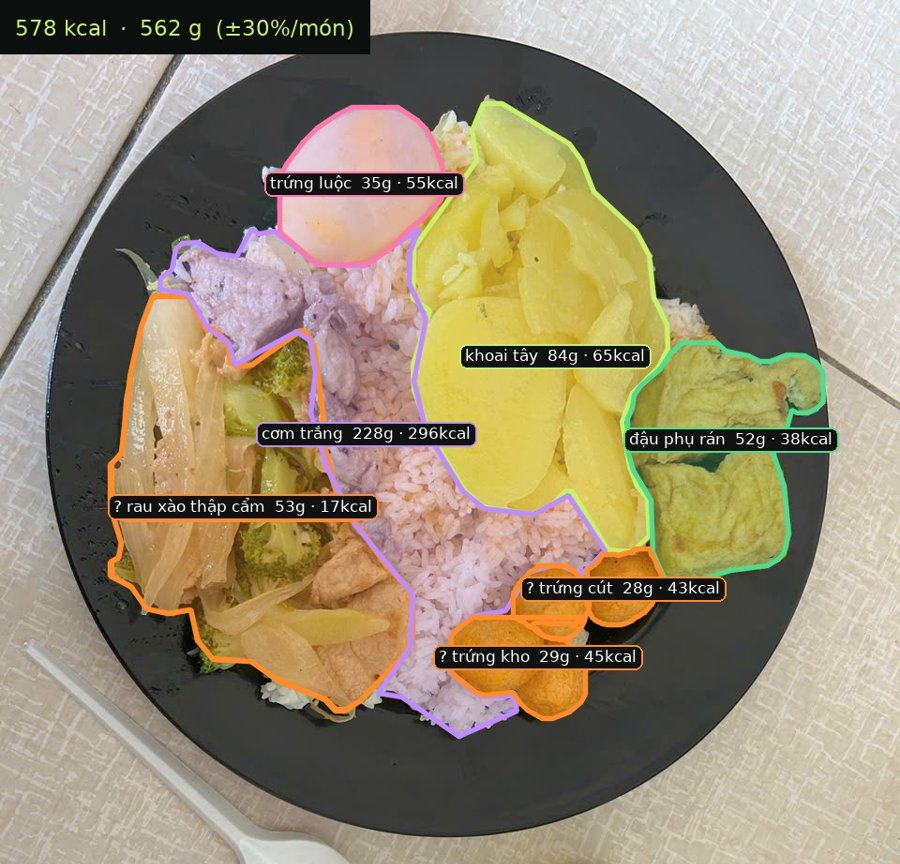

# Calo Khay: nhận diện món và ước lượng calo từ ảnh khay cơm

Đồ án môn Xử lý ảnh số. Chụp một ảnh khay cơm căng tin, chương trình sẽ:

1. **Khoanh vùng từng món** (45 món) bằng mô hình YOLO26s-seg mà nhóm đã fine-tune, rồi **phân loại lại từng vùng** bằng đặc trưng DINOv2 để giảm nhầm món và bỏ sót.
2. **Ước lượng số gram** mỗi món, dựa trên diện tích món so với đĩa (đĩa được tìm bằng YOLOE). Riêng cơm có thể ước lượng thêm bằng độ sâu (Depth-Anything-V2).
3. **Quy ra calo** theo bảng dinh dưỡng, và **đánh dấu những món mô hình chưa chắc** để người dùng xác nhận.

Mô hình **đã train sẵn** và nằm trong thư mục `models/`, nên **không cần train lại**: chỉ cần cài thư viện rồi chạy.

<p align="center"></p>

---

## 1. Cài đặt

Cần có **Python 3.10 – 3.12** và **Git**. Có GPU NVIDIA thì chạy nhanh hơn, nhưng không bắt buộc.

### Bước 1: Tải code về

```bash
git clone https://github.com/lyhaiquan/Final_Project_Digital_Image_Processing.git
cd Final_Project_Digital_Image_Processing
```

### Bước 2: Tạo môi trường ảo

**Windows (PowerShell hoặc CMD):**
```bash
python -m venv .venv
.venv\Scripts\activate
```

**macOS / Linux:**
```bash
python3 -m venv .venv
source .venv/bin/activate
```

Kích hoạt thành công thì đầu dòng lệnh sẽ có chữ `(.venv)`.

> Nếu PowerShell báo lỗi *"running scripts is disabled"*, chạy lệnh sau một lần rồi kích hoạt lại:
> `Set-ExecutionPolicy -Scope CurrentUser RemoteSigned`

### Bước 3: Cài PyTorch (chọn MỘT trong hai)

**Máy có GPU NVIDIA:**
```bash
pip install torch torchvision --index-url https://download.pytorch.org/whl/cu128
```

**Máy không có GPU (hoặc máy Mac):**
```bash
pip install torch torchvision --index-url https://download.pytorch.org/whl/cpu
```
> Trên Mac thì dùng `pip install torch torchvision`.

### Bước 4: Cài các thư viện còn lại

```bash
pip install -r requirements.txt
```

> Lần chạy đầu tiên chương trình tự tải DINOv2-base (khoảng 330 MB) về máy; các lần sau không cần mạng.

### Kiểm tra

```bash
python -c "import torch, ultralytics; print('torch', torch.__version__, '| GPU:', torch.cuda.is_available(), '| ultralytics', ultralytics.__version__)"
```

Máy có GPU thì `GPU: True`, máy chỉ có CPU thì `GPU: False`. Cả hai đều chạy được.

---

## 2. Chạy thử

Chạy trên 2 ảnh mẫu có sẵn trong `examples/`:

```bash
python predict.py examples
```

Màn hình sẽ in ra danh sách món, kiểu như:

```
== B_212.jpg  (0.6 s)
   khoai tây                84 g    65 kcal  tin cậy 0.97
   thịt xào súp lơ          53 g    19 kcal  tin cậy 0.41  <- cần xác nhận
   cơm trắng               228 g   296 kcal  tin cậy 0.86
   trứng kho                29 g    45 kcal  tin cậy 0.38  <- cần xác nhận (có thể là: cá viên)
   ...
   TỔNG                    562 g   578 kcal  (≈29% nhu cầu ngày, sai số ±30%/món)
```

Kết quả được lưu vào thư mục `outputs/`:

| File | Nội dung |
|---|---|
| `outputs/<tên ảnh>_ketqua.jpg` | Ảnh đã vẽ viền từng món, kèm tên, gram và kcal. Món **viền cam có dấu "?"** là món cần xác nhận. |
| `outputs/<tên ảnh>.json` | Toàn bộ kết quả dạng JSON, dùng cho backend/frontend (xem mục 3). |

### Chạy với ảnh của bạn

```bash
python predict.py duong/dan/anh_khay.jpg          # một ảnh
python predict.py anh1.jpg anh2.jpg                # nhiều ảnh
python predict.py thu_muc_anh/                     # cả thư mục
```

### Các tùy chọn

| Tùy chọn | Ý nghĩa |
|---|---|
| `--depth` | Ước lượng **cơm** bằng độ sâu (Depth-Anything-V2 Large) thay vì khẩu phần trung bình. Sai số tổng khay giảm từ ~113 g xuống ~83 g. **Lần đầu tự tải model khoảng 1,3 GB**; nên có GPU, vì chạy bằng CPU mất vài giây mỗi ảnh. |
| `--no-dino` | Tắt bước phân loại lại bằng DINOv2: chỉ dùng YOLO như bản cũ. Nhanh hơn (CPU: ~0,5 s thay vì ~3 s mỗi ảnh) nhưng nhầm và sót món nhiều hơn (xem mục 6). |
| `--flag-conf 0.75` | Món có độ tin cậy dưới ngưỡng này sẽ bị đánh dấu "cần xác nhận" (mặc định 0.75; với `--no-dino` là 0.5). |
| `--device cpu` | Bắt buộc chạy bằng CPU. `--device 0` để chạy bằng GPU số 0. |
| `--out ten_thu_muc` | Đổi thư mục lưu kết quả (mặc định `outputs/`). |

Ví dụ: `python predict.py examples --depth`

**Mẹo chụp ảnh để có kết quả tốt:** chụp **thẳng từ trên xuống**, **thấy trọn vành đĩa**, và các món **không chồng lên nhau**. Lý do: gram được tính theo diện tích món so với diện tích đĩa.

---

## 3. Dùng trong code (cho backend)

```python
from calo_khay import CaloKhay

ck = CaloKhay(use_depth=False)          # nạp model MỘT lần khi server khởi động (use_dino=False để tắt DINOv2)
res = ck.analyze("anh_khay.jpg")        # nhận đường dẫn ảnh hoặc ảnh numpy (BGR, đọc bằng cv2)
print(res["total"])                     # {'grams': 562, 'kcal': 578, 'error_pct': 30, 'daily_pct': 29}
```

Cấu trúc JSON trả về:

```jsonc
{
  "image": {"w": 960, "h": 1280},
  "plate_found": true,               // có tìm được đĩa không
  "plate_px": 566895,                // diện tích đĩa (pixel)
  "rice_volume": null,               // "thể tích" cơm tương đối, chỉ có khi bật depth
  "items": [
    {
      "id": 1,
      "cls": "potato",               // mã món (tiếng Anh, xem models/calories.csv)
      "name": "khoai tây",           // tên tiếng Việt
      "conf": 0.968,                 // độ tin cậy (xác suất kết hợp DINOv2 + YOLO)
      "needs_confirm": false,        // true -> giao diện hỏi lại người dùng (conf < 0.75)
      "suggestions": [],             // món có thể đúng hơn: lựa chọn thứ 2-3 của mô hình, rồi các món hay bị nhầm (mã món)
      "area_px": 88179,              // diện tích món (pixel)
      "area_ratio": 0.1555,          // diện tích món / diện tích đĩa
      "grams": 84,
      "gram_method": "area",         // area | rice_mean | rice_depth | class_mean (khi không thấy đĩa)
      "kcal": 65,
      "polygons": [[[x, y], ...]]    // viền món theo toạ độ pixel ảnh gốc, để vẽ lên ảnh
    }
  ],
  "total": {"grams": 562, "kcal": 578, "error_pct": 30, "daily_pct": 29},
  "warnings": []                     // "no_food", "no_plate", "depth_plane_failed"
}
```

Khi người dùng đổi tên món, kcal tính lại bằng: `kcal = grams × kcal_per_100g / 100`, với `kcal_per_100g` lấy từ `models/calories.csv`.

---

## 4. Cấu trúc thư mục

```
├── predict.py               chạy từ dòng lệnh
├── calo_khay/
│   ├── pipeline.py          toàn bộ các bước: phân đoạn → đĩa → (độ sâu) → gram → kcal
│   └── draw.py              vẽ kết quả lên ảnh
├── models/
│   ├── food_seg_v4_final.pt mô hình phân đoạn 45 món (nhóm tự train)
│   ├── dino_head.npz        đầu phân loại 45 món trên đặc trưng DINOv2 (fit trên nhãn train + val)
│   ├── yoloe_plate.pt       YOLOE đã gắn sẵn lớp "plate" để tìm đĩa
│   ├── gram_model.json      hệ số công thức gram (fit trên dữ liệu đã cân)
│   └── calories.csv         45 món: tên Việt, kcal/100 g, nguồn số liệu
├── examples/                ảnh mẫu
├── docs/
│   ├── benchmark_ieee.pdf   báo cáo benchmark (khổ IEEE)
│   ├── proposal_frontend.pdf thiết kế giao diện web
│   ├── NGHIEP_VU.md         đặc tả nghiệp vụ backend + frontend (bản PDF: nghiep_vu.pdf)
│   ├── REPORT_gram.md       ghi chép kết quả ước lượng gram và độ sâu
│   └── results/             số liệu gốc (CSV) của mọi bảng trong báo cáo
├── research/                code chuẩn bị dữ liệu, notebook train, script đánh giá (cần bộ dữ liệu gốc)
│   └── improve/             các thử nghiệm cải thiện sau khi train (DINOv2, gộp seed, hệ số gram...) và kết quả
└── tools/                   tạo lại gram_model.json và dino_head.npz (cần bộ dữ liệu gốc)
```

---

## 5. Cách hoạt động

| Bước | Mô hình / cách làm | Ghi chú |
|---|---|---|
| Phân đoạn món | YOLO26s-seg, ảnh 640 | Fine-tune trên 211 ảnh (train + val), 150 epoch |
| Phân loại lại | DINOv2-base (không train): trung bình đặc trưng trong mask → hồi quy logistic, kết hợp với điểm YOLO | Lấy cả mask yếu (conf ≥ 0.1), khử mask trùng, bỏ mask yếu mà DINOv2 không chắc. Tham số chọn trên tập val |
| Tìm đĩa | YOLOE-11s-seg với prompt "plate" | Chọn đĩa chứa nhiều đồ ăn nhất; nếu đĩa bị khung cắt thì fit elip để bù |
| Gram món khác cơm | `log g = a_món + b·log(diện tích món / diện tích đĩa)` | Hệ số `b` dùng chung cho mọi món, cộng hiệu chỉnh smearing |
| Gram cơm | Khẩu phần trung bình (~228 g), hoặc độ sâu nếu có `--depth` | Depth-Anything-V2: độ cao so với mặt đĩa, tính ra "thể tích" tương đối |
| Calo | `gram × kcal/100 g` | Bảng `models/calories.csv` |

## 6. Kết quả (tập test khóa: 36 ảnh, 10 khay)

Mask mAP50-95 của YOLO: **0.566 ± 0.014** (3 seed). Các chỉ số còn lại đo trên model đang dùng:

| Chỉ số | Chỉ YOLO (`--no-dino`) | + DINOv2 (mặc định) |
|---|---|---|
| Vùng món nhận đúng (trên 382) | 261 (68%) | **273 (71%)** |
| Vùng món bị bỏ sót | 41 | **33** |
| Danh sách món của ảnh (F1) | 79.5% | **84.5%** |
| Món "ma" (báo có nhưng không có) | 40 | **33** |
| Món sai mà không được gắn cờ "cần xác nhận" | 27 | **14** |
| Sai số gram mỗi món (MAE) | 26.8 g; bật độ sâu 23.8 g | 26.5 g; bật độ sâu 24.5 g |
| Sai số gram tổng khay (MAE) | 91 g; bật độ sâu 72 g | 89 g; bật độ sâu 73 g |
| Sai số kcal tổng khay (MAE) | 122 kcal; bật độ sâu 108 kcal | **111 kcal**; bật độ sâu **98 kcal** |

DINOv2 cải thiện phần **nhận diện** và **calo**; sai số **gram** gần như không đổi. Cả 3 seed đều cho cùng chiều cải thiện.
Mốc so sánh cho gram mỗi món: đoán theo khẩu phần trung bình sai 36.0 g.

Tổng khay ở bảng này tính trên mọi món chương trình báo ra, kể cả món "ma". Báo cáo `docs/benchmark_ieee.pdf` dùng cách tính cũ
(chỉ cộng các món có cân) nên ghi 113 g / 83 g cho cùng model chỉ-YOLO. Chi tiết các thử nghiệm: `research/improve/README.md`.

**Giới hạn cần biết:**
- Khoảng 9% vùng món trong test vẫn bị bỏ sót (chỉ YOLO: 11%); khoảng 20% bị nhận nhầm. Các món hay nhầm: gà chua ngọt, cá viên, gà xào ớt chuông, rau muống.
- "±30% mỗi món" chỉ đúng với khoảng 60% số món; muốn phủ khoảng 3/4 số món phải nói ±50%.
- Dữ liệu cân mới có 38 khay, nên các con số chỉ là ước lượng thô.
- Đồ đựng trong hộp (không có đĩa) sẽ kém chính xác hơn.

---

## 7. Lỗi thường gặp

| Hiện tượng | Cách xử lý |
|---|---|
| `ModuleNotFoundError: No module named 'torch'` | Chưa làm Bước 3, hoặc chưa kích hoạt `.venv`. |
| Lỗi mạng khi tải `facebook/dinov2-base` | Lần đầu cần mạng để tải DINOv2. Chưa có mạng thì chạy tạm với `--no-dino`. |
| Cảnh báo *"To support symlinks on Windows…"* | Vô hại, bỏ qua được (xuất hiện khi tải Depth-Anything lần đầu). |
| `GPU: False` dù máy có card NVIDIA | Đã cài nhầm bản CPU. Gỡ đi rồi cài lại theo Bước 3: `pip uninstall torch torchvision` |
| Lỗi khi đọc file `yoloe_plate.pt` | Kiểm tra lại phiên bản: phải đúng `ultralytics==8.4.163`. |
| Ảnh `.HEIC` (iPhone) không đọc được | Chuyển sang JPG trước khi chạy. |
| `cảnh báo: no_plate` | Không thấy đĩa: gram lấy theo khẩu phần trung bình của món. Nên chụp lại sao cho thấy rõ đĩa. |

## 8. Giấy phép thư viện

- Ultralytics YOLO: AGPL-3.0.
- DINOv2: Apache-2.0.
- Depth-Anything-V2 Large: CC-BY-NC-4.0, chỉ dùng phi thương mại.

Tất cả phù hợp cho đồ án học tập.
