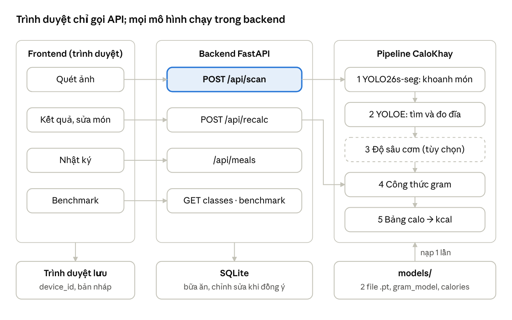

# Đặc tả nghiệp vụ chi tiết – Calo Khay

Cập nhật: 10/11/2026

## 1. Tổng quan

Calo Khay là ứng dụng web: người ăn chụp ảnh khay cơm căng tin, hệ thống nhận diện từng món, ước lượng gram và calo, rồi hỏi lại những món mô hình chưa chắc. Tài liệu này đặc tả backend trước (mục 2–3), frontend sau (mục 4–5).

### 1.1 Mục tiêu

- Trả kết quả cho một ảnh khay trong ≤ 2 giây (GPU), gồm danh sách món, gram, kcal và tổng.

- Ước lượng chỉ dựa trên ảnh: không dùng thực đơn ngày hay dữ liệu từ bếp.

- Bù sai số của mô hình bằng nghiệp vụ: đánh dấu món nghi ngờ, cho sửa, thêm, xóa món, chọn suất cơm.

- Công khai độ chính xác (trang Benchmark) để người dùng hiểu giới hạn ±30%.

### 1.2 Phạm vi

| Trong phạm vi | Ngoài phạm vi |
|----|----|
| 45 món căng tin mà mô hình food_seg_v4_final.pt đã học | Món ngoài danh sách 45 món (chỉ thêm tay được nếu có trong danh mục) |
| Ảnh khay/đĩa chụp bằng điện thoại, từ trên xuống | Video, ảnh nhiều khay cùng lúc |
| Gram, kcal từng món và cả khay | Đạm, béo, đường, vi chất |
| Nhật ký bữa ăn của một người dùng trên một thiết bị | Tài khoản, đồng bộ nhiều thiết bị, chia sẻ |
| Web chạy trên trình duyệt máy tính và điện thoại | Ứng dụng di động cài đặt (iOS/Android) |

### 1.3 Tác nhân

| Tác nhân | Mô tả | Dùng phần nào |
|----|----|----|
| Người ăn | Sinh viên/nhân viên ăn ở căng tin, muốn biết lượng calo bữa ăn | Frontend: Quét, Kết quả, Nhật ký, Bảng calo, Benchmark |
| Ứng dụng frontend | Trình duyệt gọi API thay mặt người ăn | Backend: mọi endpoint /api/\* |
| Nhóm phát triển | Vận hành server, thay model, lấy dữ liệu chỉnh sửa để cải thiện mô hình | Backend: cấu hình, endpoint quản trị, nhật ký hệ thống |

### 1.4 Thuật ngữ

| Thuật ngữ | Nghĩa |
|----|----|
| Món (class) | Một trong 45 lớp của mô hình, có mã tiếng Anh (fish_ball) và tên Việt (cá viên) |
| Vùng món | Đa giác (polygon) mô hình khoanh quanh một món trên ảnh |
| Độ tin cậy (conf) | Điểm 0–1 mô hình gán cho một vùng món |
| Cần xác nhận | Món có độ tin cậy thấp, giao diện phải hỏi lại người ăn |
| Diện tích tương đối A | Diện tích vùng món chia diện tích đĩa; dùng để quy ra gram |
| Thể tích tương đối V | Tổng độ cao của cơm so với mặt đĩa (từ Depth-Anything-V2) chia diện tích đĩa |
| Bữa ăn | Một lần quét đã được người ăn lưu vào nhật ký, kèm các chỉnh sửa |

### 1.5 Kiến trúc tổng thể

Frontend chỉ gọi API; mọi mô hình chạy ở backend FastAPI và được nạp một lần lúc khởi động. Code lõi đã có trong repo [Final_Project_Digital_Image_Processing](https://github.com/lyhaiquan/Final_Project_Digital_Image_Processing) (calo_khay/pipeline.py).

kiến trúc · frontend, backend FastAPI, pipeline 5 bước

Đường chính (viền xanh): ảnh đi từ trang Quét qua POST /api/scan vào pipeline 5 bước; bước 3 chỉ chạy khi bật độ sâu. Sửa món gọi /api/recalc, chỉ chạy lại bước 4–5.

## 2. Backend: chức năng

Backend là một server FastAPI bọc pipeline CaloKhay (YOLO26s-seg → YOLOE tìm đĩa → Depth-Anything-V2 cho cơm → công thức gram → bảng calo) thành API JSON, kèm lưu nhật ký bữa ăn bằng SQLite.

### 2.1 Tính năng

| Mã | Tính năng | Mô tả ngắn |
|----|----|----|
| BE-F1 | Phân tích ảnh khay | Nhận ảnh, trả danh sách món (vùng, độ tin cậy, gram, kcal), tổng và cảnh báo |
| BE-F2 | Danh mục món | Trả 45 món: mã, tên Việt, kcal/100 g, gram mặc định, nhóm hay nhầm |
| BE-F3 | Tính lại | Tính lại gram/kcal khi người ăn đổi món, thêm món, xóa món, chọn suất cơm |
| BE-F4 | Nhật ký bữa ăn | Lưu, xem, xóa bữa ăn; tổng kcal theo ngày |
| BE-F5 | Thu thập chỉnh sửa | Chỉ khi người ăn đồng ý: lưu ảnh + kết quả mô hình + bản đã sửa, để nhóm gán nhãn và train lại |
| BE-F6 | Số liệu Benchmark | Trả benchmark.json (mAP, sai số gram, AP từng món) cho trang Benchmark |
| BE-F7 | Giám sát | /api/health: trạng thái, phiên bản model, có GPU không, có bật độ sâu không |

### 2.2 Use case

| Mã     | Use case                        | Tác nhân          | Tính năng    |
|--------|---------------------------------|-------------------|--------------|
| UC-B01 | Phân tích ảnh khay              | Ứng dụng frontend | BE-F1        |
| UC-B02 | Lấy danh mục món                | Ứng dụng frontend | BE-F2        |
| UC-B03 | Tính lại kết quả sau khi sửa    | Ứng dụng frontend | BE-F3        |
| UC-B04 | Lưu bữa ăn                      | Ứng dụng frontend | BE-F4, BE-F5 |
| UC-B05 | Xem / xóa nhật ký               | Ứng dụng frontend | BE-F4        |
| UC-B06 | Xuất dữ liệu chỉnh sửa          | Nhóm phát triển   | BE-F5        |
| UC-B07 | Thay model / cập nhật bảng calo | Nhóm phát triển   | BE-F1, BE-F2 |
| UC-B08 | Kiểm tra tình trạng server      | Nhóm phát triển   | BE-F7        |

**UC-B01: Phân tích ảnh khay** (use case chính)

- Tiền điều kiện: server đã nạp xong model; /api/health trả ok.

- Luồng chính:

  1.  Frontend gửi POST /api/scan kèm ảnh (multipart, trường image) và tuỳ chọn depth.

  2.  Backend kiểm tra ảnh (QT-07), xoay theo EXIF.

  3.  Phân đoạn món, giữ vùng có độ tin cậy ≥ 0.25 (QT-01).

  4.  Tìm đĩa chứa nhiều đồ ăn nhất, tính diện tích đĩa (fit elip nếu đĩa bị khung cắt).

  5.  Gộp vùng cùng món thành một dòng (QT-08); tính gram (QT-03, QT-04), kcal (QT-05).

  6.  Đánh dấu món cần xác nhận và gợi ý món hay nhầm (QT-01, QT-02).

  7.  Trả JSON kết quả kèm scan_id; giữ kết quả tạm 24 giờ để UC-B04 dùng lại.

- Luồng thay thế:

  - A1. Không thấy món nào → trả items rỗng + cảnh báo no_food, HTTP 200.

  - A2. Không thấy đĩa → mọi món lấy gram theo khẩu phần trung bình của món + cảnh báo no_plate.

  - A3. Bật độ sâu nhưng không fit được mặt đĩa → cơm lấy khẩu phần trung bình + cảnh báo depth_plane_failed.

- Luồng lỗi:

  - E1. File không phải ảnh, sai định dạng, quá 10 MB hoặc cạnh ngắn \< 320 px → HTTP 400/413 kèm mã lỗi (bảng 2.6).

  - E2. Server đang quá tải (hàng chờ \> 8 ảnh) → HTTP 503 busy, frontend thử lại sau.

- Hậu điều kiện: không lưu ảnh lâu dài nếu người ăn chưa đồng ý (QT-09).

**UC-B03: Tính lại sau khi sửa.** Frontend gửi danh sách món cuối cùng (mã món, gram hoặc area_ratio, nguồn: model / renamed / manual). Backend tính lại gram cho món đổi tên từ cùng diện tích vùng (công thức của món mới), gán gram mặc định cho món thêm tay (QT-10), rồi trả kcal và tổng mới.

**UC-B04: Lưu bữa ăn.** Frontend gửi scan_id, danh sách món cuối cùng, thời điểm ăn và cờ share_corrections. Backend lưu bữa ăn; nếu cờ bật thì lưu thêm ảnh, kết quả gốc của mô hình và bản đã sửa (BE-F5).

### 2.3 Yêu cầu chức năng

| Mã | Yêu cầu | Use case |
|----|----|----|
| FR-B01 | Nhận ảnh JPG, PNG, WebP qua multipart; từ chối định dạng khác bằng kiểm tra nội dung file, không chỉ đuôi | UC-B01 |
| FR-B02 | Xoay ảnh theo EXIF trước khi suy luận; tọa độ trả về theo ảnh đã xoay | UC-B01 |
| FR-B03 | Phân đoạn bằng food_seg_v4_final.pt, ảnh 640, ngưỡng 0.25, mask độ phân giải gốc | UC-B01 |
| FR-B04 | Mỗi món một dòng: gộp các vùng cùng món, độ tin cậy = cao nhất, giữ tất cả đa giác | UC-B01 |
| FR-B05 | Tìm đĩa bằng yoloe_plate.pt (ngưỡng 0.1); chọn đĩa phủ \> 30% đồ ăn; fit elip khi \> 2% viền sát mép ảnh | UC-B01 |
| FR-B06 | Tính gram, kcal theo QT-03, QT-04, QT-05; làm tròn đến 1 g và 1 kcal | UC-B01, UC-B03 |
| FR-B07 | Gắn needs_confirm và suggestions theo QT-01, QT-02 | UC-B01 |
| FR-B08 | Trả cảnh báo dạng mã: no_food, no_plate, depth_plane_failed, blurry | UC-B01 |
| FR-B09 | Tham số depth bật/tắt ước lượng cơm bằng độ sâu; mặc định theo cấu hình server | UC-B01 |
| FR-B10 | Trả model_version và thời gian xử lý từng bước trong mỗi kết quả | UC-B01 |
| FR-B11 | GET /api/classes trả 45 món từ calories.csv và gram_model.json | UC-B02 |
| FR-B12 | Tính lại khi đổi tên món: dùng lại area_ratio của vùng với hệ số của món mới | UC-B03 |
| FR-B13 | Món thêm tay: gram = khẩu phần trung bình của món, người ăn sửa được; không có vùng trên ảnh | UC-B03 |
| FR-B14 | Cơm: cho chọn suất 150 / 227 / 300 g, ghi đè gram ước lượng | UC-B03 |
| FR-B15 | Lưu, liệt kê theo ngày, xóa bữa ăn; tổng kcal ngày và % so với 2.000 kcal | UC-B04, UC-B05 |
| FR-B16 | Chỉ lưu ảnh và chỉnh sửa khi share_corrections = true | UC-B04 |
| FR-B17 | Xuất chỉnh sửa ra thư mục ảnh + nhãn định dạng YOLO để nhóm gán lại | UC-B06 |
| FR-B18 | Đổi model / bảng calo bằng cách thay file trong models/ và khởi động lại, không sửa code | UC-B07 |
| FR-B19 | GET /api/health trả trạng thái nạp model, GPU, phiên bản | UC-B08 |

### 2.4 Quy tắc nghiệp vụ

| Mã | Quy tắc |
|----|----|
| QT-01 | Vùng có độ tin cậy ≥ 0.25 mới hiển thị; \< 0.5 thì gắn “Cần xác nhận”. Ngưỡng 0.5 là cấu hình được. |
| QT-02 | Món thuộc nhóm hay nhầm kèm gợi ý: cá viên ↔ trứng kho, trứng rán, trứng cút; su su ↔ bắp cải, trứng luộc; rau muống ↔ rau xanh; gà chua ngọt ↔ gà rán; đậu rán ↔ chả quế; gà xào ớt chuông ↔ thịt kho. |
| QT-03 | Món khác cơm: gram = exp(a_món + b · ln A) · smearing; món có \< 3 khay trong dữ liệu fit dùng hệ số chung. Không thấy đĩa → khẩu phần trung bình của món. |
| QT-04 | Cơm: bật độ sâu và V \> 0 → gram = exp(a + b · ln V) · smearing; ngược lại 228 g (khẩu phần trung bình). Người ăn chọn suất 150 / 227 / 300 g thì lấy suất đó. |
| QT-05 | kcal = gram × kcal/100 g ÷ 100 theo calories.csv; đồ uống tính 0 kcal. |
| QT-06 | Mọi con số hiển thị kèm sai số ±30% mỗi món. |
| QT-07 | Ảnh hợp lệ: JPG/PNG/WebP, ≤ 10 MB, cạnh ngắn ≥ 320 px. Ảnh mờ (độ nét Laplacian dưới ngưỡng) vẫn xử lý nhưng kèm cảnh báo blurry. |
| QT-08 | Mỗi món một dòng, sắp theo diện tích giảm dần. |
| QT-09 | Ảnh và chỉnh sửa chỉ được lưu lâu dài khi người ăn bật “Góp ảnh để cải thiện mô hình”. Kết quả tạm bị xóa sau 24 giờ. |
| QT-10 | Món thêm tay chọn từ 45 món; gram mặc định = khẩu phần trung bình, người ăn sửa được 10–1.000 g. |
| QT-11 | % nhu cầu ngày tính theo 2.000 kcal. |

### 2.5 API

| Endpoint | Vào | Ra |
|----|----|----|
| POST /api/scan | multipart image; query depth (true/false), flag_conf | scan_id, image{w,h}, plate_found, items\[\], total{grams,kcal,error_pct,daily_pct}, warnings\[\], model_version, timing_ms |
| GET /api/classes | — | 45 món: cls, name, kcal_per_100g, default_g, suggestions\[\] |
| POST /api/recalc | scan_id?, items\[\] (cls, source, area_ratio? grams?) | items\[\] có gram/kcal mới, total |
| POST /api/meals | scan_id, items\[\], eaten_at, share_corrections | meal_id |
| GET /api/meals?date=YYYY-MM-DD | — | danh sách bữa + tổng ngày |
| DELETE /api/meals/{id} | — | 204 |
| GET /api/benchmark | — | nội dung benchmark.json |
| GET /api/health | — | status, model_version, gpu, depth_enabled |

Mỗi items\[\] của /api/scan giữ đúng cấu trúc JSON trong README của repo: id, cls, name, conf, needs_confirm, suggestions, area_px, area_ratio, grams, gram_method, kcal, polygons.

### 2.6 Mã lỗi

| HTTP | Mã | Khi nào | Frontend hiển thị |
|----|----|----|----|
| 400 | invalid_image | Không đọc được ảnh, sai định dạng | “Ảnh không hợp lệ, hãy chọn JPG hoặc PNG” |
| 400 | image_too_small | Cạnh ngắn \< 320 px | “Ảnh quá nhỏ, hãy chụp gần hơn” |
| 413 | image_too_large | \> 10 MB | “Ảnh quá lớn (tối đa 10 MB)” |
| 404 | scan_expired | scan_id quá 24 giờ | “Kết quả đã hết hạn, hãy quét lại” |
| 422 | unknown_class | Mã món không có trong 45 món | Lỗi nội bộ, ghi log |
| 503 | busy / model_loading | Hàng chờ đầy / model chưa nạp xong | “Máy đang bận, thử lại sau vài giây” |

### 2.7 Dữ liệu

| Thực thể | Trường chính | Lưu ở đâu |
|----|----|----|
| FoodClass | cls, name_vi, kcal_per_100g, source, default_g | models/calories.csv, gram_model.json (chỉ đọc) |
| ScanResult | scan_id, kết quả JSON của mô hình, created_at | Bộ nhớ tạm / SQLite, xóa sau 24 giờ |
| Meal | meal_id, device_id, eaten_at, total_g, total_kcal, model_version | SQLite |
| MealItem | meal_id, cls, grams, kcal, source (model / renamed / manual), orig_cls, conf | SQLite |
| Correction | meal_id, đường dẫn ảnh, kết quả gốc, kết quả đã sửa | SQLite + thư mục ảnh, chỉ khi đồng ý |

device_id là mã ngẫu nhiên frontend tạo và giữ trong trình duyệt; hệ thống không có tài khoản và không lưu tên, email.

## 3. Backend: yêu cầu phi chức năng

Mục tiêu hiệu năng dựa trên số đo thật trên laptop RTX 3050 Ti: 0,4–0,7 giây/ảnh khi tắt độ sâu, khoảng 1,3 giây khi bật, sau lần chạy đầu ~7 giây để khởi động model.

| Mã | Nhóm | Yêu cầu | Cách kiểm tra |
|----|----|----|----|
| NFR-B01 | Hiệu năng | /api/scan ≤ 1 giây (GPU, tắt độ sâu), ≤ 2 giây (GPU, bật độ sâu), ≤ 5 giây (CPU, tắt độ sâu), tính ở phân vị 95 | Đo timing_ms trên 36 ảnh test |
| NFR-B02 | Hiệu năng | Nạp model một lần khi khởi động và chạy một ảnh làm nóng; request đầu tiên không phải chờ nạp | /api/health chỉ trả ok sau khi làm nóng xong |
| NFR-B03 | Tải | Một GPU xử lý tuần tự qua hàng chờ; tối đa 8 ảnh chờ, quá thì trả 503 busy | Gửi 20 request cùng lúc |
| NFR-B04 | Đúng đắn | Kết quả trên tập test phải khớp báo cáo: MAE món 26,8 g (tắt độ sâu) / 23,8 g (bật), MAE tổng khay 112,9 / 82,8 g | Test hồi quy chạy mỗi khi đổi model hoặc code |
| NFR-B05 | Đúng đắn | Cùng ảnh, cùng tham số → cùng kết quả (không ngẫu nhiên) | Gọi 2 lần, so JSON |
| NFR-B06 | Tin cậy | Ảnh xấu không làm sập server: mọi lỗi đầu vào trả 4xx có mã, không trả 500 | Gửi file rỗng, PDF, ảnh 1×1 px |
| NFR-B07 | Tin cậy | Thiếu đĩa / lỗi độ sâu vẫn trả kết quả bằng phương án dự phòng kèm cảnh báo | Ảnh không có đĩa (đồ đựng hộp) |
| NFR-B08 | Bảo mật | Giới hạn 10 MB; kiểm tra nội dung file; CORS chỉ cho tên miền của frontend; không chạy code từ dữ liệu người dùng gửi | Rà soát code, test file giả mạo đuôi |
| NFR-B09 | Riêng tư | Không tài khoản, không lưu tên/email; ảnh xóa sau 24 giờ trừ khi người ăn đồng ý góp ảnh; log không chứa ảnh | Kiểm tra thư mục tạm sau 24 giờ |
| NFR-B10 | Bảo trì | Model, hệ số gram, bảng calo là file trong models/; thay file + khởi động lại là đổi được; ghim ultralytics==8.4.163 | Thay calories.csv, kiểm tra kcal mới |
| NFR-B11 | Quan sát | Log mỗi request: thời gian từng bước, số món, cảnh báo, model_version; không log nội dung ảnh | Đọc log sau 10 request |
| NFR-B12 | Di động | Chạy trên Windows và Linux, Python 3.10–3.12; tự chuyển sang CPU khi không có GPU | Chạy trên máy không GPU |
| NFR-B13 | Tài liệu | FastAPI tự sinh /docs (OpenAPI); mọi trường JSON có mô tả | Mở /docs |
| NFR-B14 | Giấy phép | Ultralytics AGPL-3.0, Depth-Anything-V2 Large CC-BY-NC-4.0: chỉ dùng phi thương mại, ghi rõ trong README và trang Giới thiệu | Rà soát trước khi công khai |
| NFR-B15 | Triển khai | Chạy bằng một lệnh uvicorn app:app, phục vụ luôn frontend đã build; RAM ≤ 4 GB khi tắt độ sâu | Chạy trên máy sạch theo README |

## 4. Frontend: chức năng

Frontend là web một trang theo hướng thiết kế “Quét AI” (nền tối, nhấn xanh chanh \#C8F06A, khung ngắm kiểu camera), gọi các API ở mục 2.5. Giai đoạn đầu chạy trên dữ liệu giả mock/scan.json có cùng cấu trúc, nên làm song song với backend.

### 4.1 Tính năng

| Mã | Tính năng | Màn hình |
|----|----|----|
| FE-F1 | Tải / chụp ảnh khay | Quét |
| FE-F2 | Xem kết quả: viền món trên ảnh, tổng kcal, thanh tỷ lệ, danh sách món | Kết quả |
| FE-F3 | Xác nhận món nghi ngờ bằng gợi ý một chạm | Kết quả (thẻ hỏi) |
| FE-F4 | Sửa kết quả: đổi món, xóa món, thêm món bị sót, chỉnh gram, chọn suất cơm | Kết quả, bảng chọn món |
| FE-F5 | Lưu vào nhật ký, tuỳ chọn góp ảnh | Kết quả |
| FE-F6 | Nhật ký theo ngày | Nhật ký |
| FE-F7 | Tra bảng calo 45 món | Bảng calo |
| FE-F8 | Xem độ chính xác của mô hình | Benchmark |

### 4.2 Use case

| Mã | Use case | Tác nhân | API dùng |
|----|----|----|----|
| UC-F01 | Quét khay cơm | Người ăn | POST /api/scan |
| UC-F02 | Xác nhận món cần xác nhận | Người ăn | POST /api/recalc |
| UC-F03 | Đổi tên một món bất kỳ | Người ăn | GET /api/classes, POST /api/recalc |
| UC-F04 | Thêm món bị sót | Người ăn | GET /api/classes, POST /api/recalc |
| UC-F05 | Xóa món nhận nhầm | Người ăn | POST /api/recalc |
| UC-F06 | Chọn suất cơm / chỉnh gram | Người ăn | POST /api/recalc |
| UC-F07 | Lưu bữa vào nhật ký | Người ăn | POST /api/meals |
| UC-F08 | Xem / xóa nhật ký | Người ăn | GET, DELETE /api/meals |
| UC-F09 | Tra bảng calo | Người ăn | GET /api/classes |
| UC-F10 | Xem Benchmark | Người ăn | GET /api/benchmark |

**UC-F01: Quét khay cơm**

1.  Người ăn mở trang Quét, kéo-thả ảnh, bấm chọn ảnh hoặc mở camera (điện thoại).

2.  Giao diện hiện ảnh xem trước, kiểm tra định dạng và dung lượng ngay trên trình duyệt.

3.  Người ăn bấm **Bắt đầu quét**; giao diện hiện hiệu ứng tia quét, khóa nút, gửi POST /api/scan.

4.  Nhận kết quả → chuyển sang màn Kết quả.

- Thay thế: có cảnh báo no_plate / blurry → vẫn hiện kết quả, kèm dải thông báo vàng và nút **Chụp lại**.

- Thay thế: no_food → màn trống “Không thấy món nào”, nút **Chụp lại** và **Thêm món thủ công**.

- Lỗi: mã lỗi 4xx/503 → hiện thông báo theo bảng 2.6; mất mạng → “Không kết nối được máy chủ” + nút **Thử lại**.

**UC-F02: Xác nhận món cần xác nhận**

1.  Món needs_confirm = true có viền cam, nhãn “? Cần xác nhận”.

2.  Thẻ hỏi “Vùng màu cam là món gì?” hiện tối đa 3 lựa chọn: món mô hình đoán + các suggestions, kèm **Khác…** (mở bảng chọn 45 món) và **Không phải món ăn** (xóa).

3.  Người ăn chọn → gọi POST /api/recalc → gram, kcal, tổng cập nhật; thẻ chuyển sang món cần xác nhận tiếp theo.

4.  Hết món cần xác nhận → ẩn thẻ.

- Người ăn bỏ qua → vẫn lưu được; món giữ tên mô hình đoán và được đánh dấu “chưa xác nhận” trong nhật ký.

**UC-F04: Thêm món bị sót.** Bấm **+ Thêm món bị sót** → bảng chọn 45 món có ô tìm kiếm (gõ không dấu vẫn ra: “ca vien” → cá viên) → chọn món → gram mặc định hiện sẵn, sửa được → món mới xuất hiện trong danh sách với nhãn “thêm tay”, không có viền trên ảnh.

**UC-F07: Lưu bữa.** Bấm **Lưu vào nhật ký** → hộp thoại xác nhận giờ ăn (mặc định: bây giờ) và ô tick **Góp ảnh để cải thiện mô hình** (mặc định tắt) → lưu → thông báo “Đã lưu” + link sang Nhật ký.

### 4.3 Yêu cầu chức năng theo màn hình

| Mã | Màn hình | Yêu cầu |
|----|----|----|
| FR-F01 | Quét | Vùng kéo-thả + nút chọn ảnh; trên điện thoại mở camera sau (capture=environment) |
| FR-F02 | Quét | Chặn trước khi gửi: sai định dạng, \> 10 MB; ảnh HEIC báo “Hãy chuyển sang JPG” |
| FR-F03 | Quét | Hiện 3 mẹo chụp: thẳng từ trên, thấy trọn vành đĩa, món không chồng nhau |
| FR-F04 | Quét | Trạng thái đang quét: tia quét chạy trên ảnh, nút bị khóa, hủy được; quá 15 giây thì báo lỗi và cho thử lại |
| FR-F05 | Kết quả | Vẽ đa giác từng món lên ảnh bằng SVG theo tọa độ gốc, co giãn theo khung; mỗi món một màu, cơm màu xám nhạt, món cần xác nhận màu cam |
| FR-F06 | Kết quả | Nhãn trên ảnh: tên + kcal (web), chỉ tên (điện thoại); bấm nhãn hoặc vùng → làm nổi dòng tương ứng trong danh sách |
| FR-F07 | Kết quả | Tổng kcal cỡ lớn, tổng gram, “±30%/món”, % nhu cầu ngày (2.000 kcal) |
| FR-F08 | Kết quả | Thanh tỷ lệ calo: mỗi đoạn một món cùng màu viền + một câu tóm tắt (vd. “Cơm chiếm hơn một nửa số calo”) |
| FR-F09 | Kết quả | Thẻ hỏi cho món cần xác nhận (UC-F02); số cập nhật ngay sau khi chọn |
| FR-F10 | Kết quả | Danh sách món: tên, gram, kcal; bấm một dòng → menu Đổi món / Chỉnh gram / Xóa |
| FR-F11 | Kết quả | Dòng cơm có 3 nút suất 150 / 227 / 300 g |
| FR-F12 | Kết quả | Nút **+ Thêm món bị sót** và **Lưu vào nhật ký**; hoàn tác được thao tác xóa gần nhất |
| FR-F13 | Bảng chọn món | 45 món, tìm kiếm không dấu, hiện kcal/100 g; trên điện thoại dạng bottom sheet |
| FR-F14 | Nhật ký | Chọn ngày; danh sách bữa (giờ, ảnh thu nhỏ, kcal); tổng ngày và % 2.000 kcal; xóa bữa có hỏi lại |
| FR-F15 | Bảng calo | Bảng 45 món: tên, kcal/100 g, nguồn số liệu; tìm kiếm, sắp xếp |
| FR-F16 | Benchmark | 4 chỉ số chính, đóng góp từng cải tiến, sai số gram so với mốc, AP từng món, cặp món hay nhầm; số liệu lấy từ GET /api/benchmark, không gõ cứng |
| FR-F17 | Chung | Thanh điều hướng: Quét · Nhật ký · Bảng calo · Benchmark; giữ kết quả đang sửa khi chuyển trang |
| FR-F18 | Chung | URL cấu hình API bằng biến môi trường; chế độ mock đọc mock/scan.json khi chưa có backend |

## 5. Frontend: yêu cầu phi chức năng

| Mã | Nhóm | Yêu cầu | Cách kiểm tra |
|----|----|----|----|
| NFR-F01 | Hiển thị | Responsive từ 360 px đến 1440 px; điện thoại xếp dọc theo thứ tự ảnh → tổng → thẻ hỏi → danh sách; không cuộn ngang | Xem ở 360, 768, 1280 px |
| NFR-F02 | Hiệu năng | Trang đầu hiển thị ≤ 2 giây trên 4G; gói JS ≤ 300 KB (gzip) | Lighthouse ≥ 80 điểm Performance |
| NFR-F03 | Hiệu năng | Thu nhỏ ảnh trên trình duyệt còn cạnh dài ≤ 1600 px trước khi gửi; sửa món cập nhật số ≤ 300 ms | Đo trên điện thoại tầm trung |
| NFR-F04 | Dễ dùng | Quét xong một khay và lưu ≤ 3 thao tác khi không có món cần xác nhận; xác nhận một món = 1 chạm | Thử với 5 người dùng |
| NFR-F05 | Dễ dùng | Mọi con số gram/kcal có chú thích “ước lượng ±30%”; không hiển thị số thập phân | Rà soát giao diện |
| NFR-F06 | Tiếp cận | Tương phản chữ ≥ 4.5:1 (WCAG AA); vùng bấm ≥ 44 px; dùng được bằng bàn phím; màu không phải tín hiệu duy nhất (món cần xác nhận có thêm dấu “?”) | axe DevTools, thử bằng Tab |
| NFR-F07 | Ngôn ngữ | Toàn bộ giao diện tiếng Việt; font có đủ dấu (Inter, Space Grotesk, JetBrains Mono) | Rà soát chữ |
| NFR-F08 | Tương thích | Chrome, Edge, Safari, Firefox bản 2 năm gần nhất; Safari iOS và Chrome Android | Thử trên 4 trình duyệt |
| NFR-F09 | Tin cậy | Mất mạng hoặc lỗi server không làm mất kết quả đang sửa; bản nháp giữ trong trình duyệt đến khi lưu | Tắt mạng giữa chừng |
| NFR-F10 | Riêng tư | Không có đăng nhập; device_id ngẫu nhiên lưu ở trình duyệt; ô “Góp ảnh” mặc định tắt và giải thích ảnh dùng để làm gì | Rà soát luồng lưu |
| NFR-F11 | Nhất quán | Màu, cỡ chữ, khoảng cách theo bộ token của bản thiết kế “Quét AI” (nền \#0B0F0D, nhấn \#C8F06A, cảnh báo cam) | So với proposal giao diện |
| NFR-F12 | Bảo trì | Tách lớp gọi API riêng, đổi mock ↔ thật bằng một biến môi trường; component dùng chung cho web và điện thoại | Rà soát code |
| NFR-F13 | Kiểm thử | Có test cho phần tính lại tổng, vẽ đa giác theo tỉ lệ, xử lý mọi mã lỗi ở bảng 2.6 | Chạy test tự động |

## 6. Truy vết và câu hỏi mở

### 6.1 Ma trận truy vết

| Nhu cầu người ăn | Use case frontend | Use case backend | Yêu cầu | API |
|----|----|----|----|----|
| Biết khay cơm bao nhiêu calo | UC-F01 | UC-B01 | FR-F01–F08, FR-B01–B10 | POST /api/scan |
| Sửa khi máy đoán sai | UC-F02, UC-F03, UC-F05 | UC-B03 | FR-F09–F10, FR-F13, FR-B12 | POST /api/recalc |
| Bổ sung món máy bỏ sót | UC-F04 | UC-B02, UC-B03 | FR-F12–F13, FR-B11, FR-B13 | GET /api/classes, POST /api/recalc |
| Điều chỉnh lượng cơm | UC-F06 | UC-B03 | FR-F11, FR-B14 | POST /api/recalc |
| Theo dõi calo theo ngày | UC-F07, UC-F08 | UC-B04, UC-B05 | FR-F14, FR-B15–B16 | /api/meals |
| Biết độ tin cậy của con số | UC-F09, UC-F10 | UC-B02 | FR-F15–F16, NFR-F05 | GET /api/classes, GET /api/benchmark |
| Nhóm cải thiện mô hình | — | UC-B06, UC-B07 | FR-B16–B18 | xuất file nội bộ |

### 6.2 Ngoài phạm vi

- Dữ liệu thực đơn ngày từ bếp ăn (nhóm không có nguồn dữ liệu này).

- Tài khoản, đăng nhập, đồng bộ nhiều thiết bị.

- Chất dinh dưỡng ngoài calo; tư vấn chế độ ăn.

- Thu thập thêm ảnh và train lại trong thời gian làm đồ án.

### 6.3 Câu hỏi mở

- [ ] Ngưỡng “Cần xác nhận” giữ 0.5 hay nâng lên 0.6 + thêm quy tắc “một vùng bị đoán thành 2 món”? Trên test, 0.6 + chồng lấn gắn cờ 25% vùng và bắt 52% vùng sai, so với 19% và 38% của 0.5.

- [ ] Bật độ sâu cho cơm mặc định không? Cần GPU và thêm ~1,3 GB model; giảm sai số tổng khay 113 → 83 g.

- [ ] Server đặt ở đâu khi demo: laptop có GPU của nhóm hay dịch vụ miễn phí chạy CPU (chậm hơn, không nên bật độ sâu)?

- [ ] Thời gian giữ kết quả tạm 24 giờ có phù hợp không?

- [ ] Một số món trong calories.csv mới tính theo nguyên liệu (chưa tính dầu, nước kho): ai rà soát lại theo Bảng thành phần thực phẩm Việt Nam?
